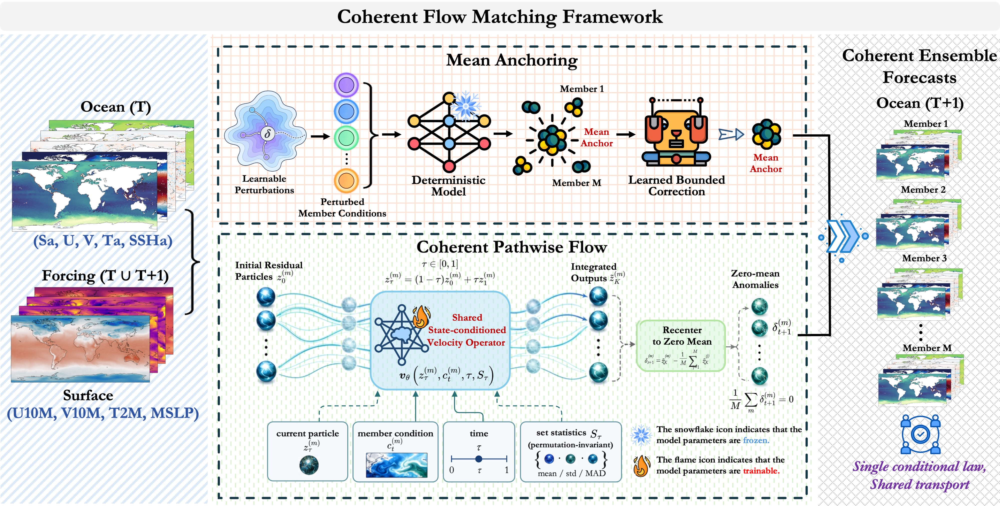
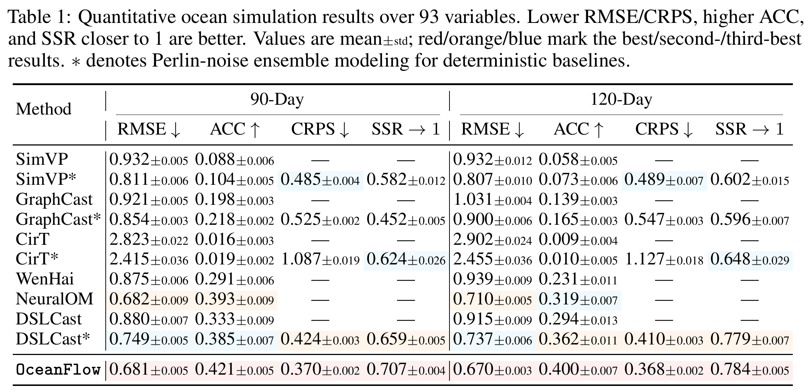
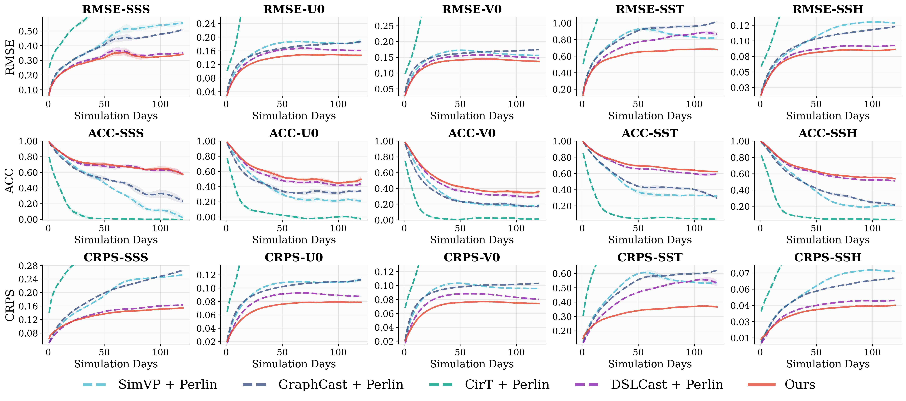
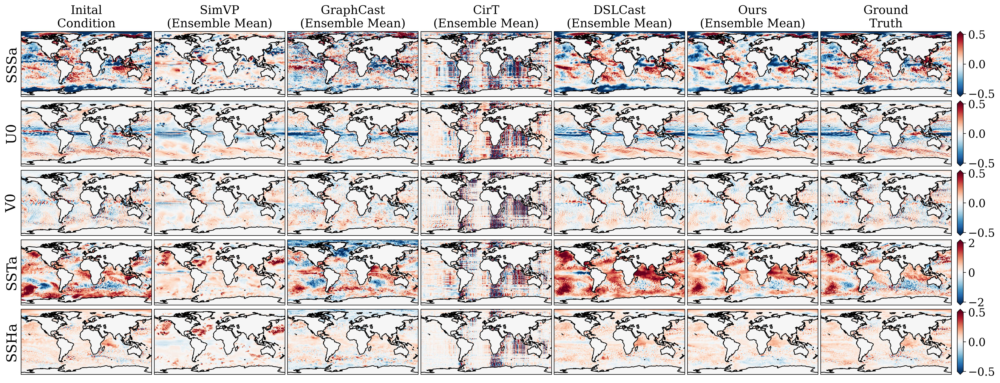
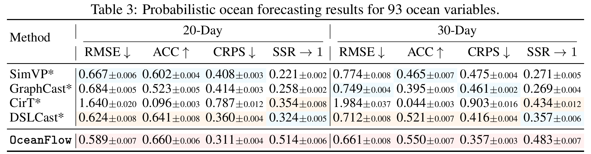
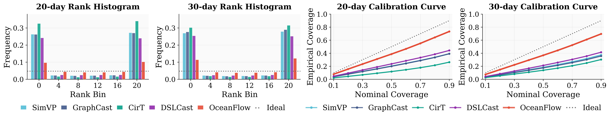
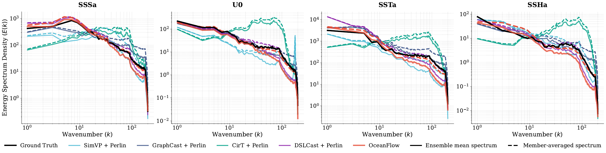
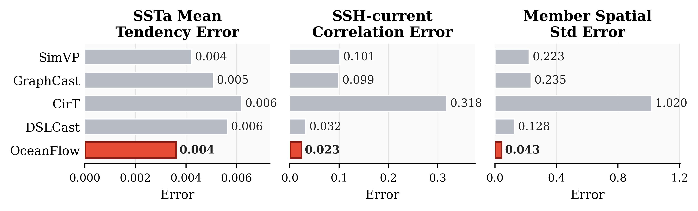

# <p align="center">OceanFlow: Coherent Flow Matching for Probabilistic Ocean Modeling</p>

<div align="center">

[](https://github.com/YuanGao-YG/OceanFlow)
[Quick Start](#quick-start) | [Training](#training) | [Performance](#performance) | [Citation](#citation)

</div>

<!-- Add the arXiv and checkpoint download links here when available. -->

<div align="center">
  
</div>

---

> **OceanFlow: Coherent Flow Matching for Probabilistic Ocean Modeling**<br>
> [Yuan Gao](https://scholar.google.com.hk/citations?user=4JpRnU4AAAAJ)<sup>† </sup>, [Fan Xu](https://scholar.google.com.hk/citations?user=qfMSkBgAAAAJ)<sup>† </sup>, [Hao Wu](https://alexander-wu.github.io/)<sup>* </sup>,<sup>† </sup> [Xiaomeng Huang](https://scholar.google.com.hk/citations?user=yH9OkqYAAAAJ)<sup>* </sup>

> (&dagger; Equal contribution, * Corresponding author)

> **Abstract:** *Probabilistic ocean modeling is essential for risk-aware marine operations, climate analysis, and scientific decision-making, where downstream decisions depend on the conditional distribution of future ocean states rather than a single deterministic trajectory. Recent data-driven ocean models have made deterministic global ocean modeling increasingly accurate and efficient, but probabilistic ocean modeling remains underdeveloped. Specifically, perturbation-driven ensembles can create spread without explicitly optimizing the joint distribution of their members, often yielding poor calibration and physical inconsistency. To address these issues, we propose OceanFlow, a coherent flow matching framework for probabilistic global ocean modeling. OceanFlow first establishes a sharp, stable mean anchor for the conditional ensemble. Flow matching then learns a coherent state-conditioned pathwise law that jointly reshapes the residual distribution around this anchor at each transition, preserving the predictive center while refining state-dependent uncertainty. We further introduce a Factorized Dynamics Operator (FDO), which combines factorized transitions with a learned state-conditioned response to parameterize the mean anchor and residual-flow velocity. Extensive experiments show that OceanFlow improves ensemble-mean accuracy, probabilistic reliability, and physical-consistency diagnostics over competitive baselines, supporting coherent flow matching as an effective route toward data-driven probabilistic ocean modeling.*

---

## Quick Start

### Installation

The provided environment targets Linux with Python 3.10, PyTorch 2.4, and CUDA 11.8.

```bash
git clone https://github.com/YuanGao-YG/OceanFlow.git
cd OceanFlow
conda env create -n oceanflow -f environment.yml
conda activate oceanflow
```

### Data Preparation

Continue update

### Inference

Continue update

## Training

Continue update

## Performance

All results below are from the main paper. Values are mean +/- standard deviation across 20 initial conditions. Lower RMSE and CRPS, higher ACC, and SSR closer to one are better. Shading marks the top three results.

### Global Ocean Simulation

The complete main simulation table compares deterministic and ensemble methods over 93 ocean variables under prescribed atmospheric forcing. A dash indicates that the metric is not reported for a deterministic model.

<div align="center">
  
</div>

**Variable-level simulation results.** RMSE, ACC, and CRPS across representative surface variables over the 120-day simulation.

<div align="center">
  
</div>

**120-day ocean fields.** Spatial comparisons of ensemble means and ground truth for representative surface variables.

<div align="center">
  
</div>

### Global Ocean Forecasting

The complete main forecasting table reports results over 93 ocean variables using atmospheric forecasts from OneForecast.

<div align="center">
  
</div>

**Forecast reliability.** Rank histograms and calibration curves under predicted atmospheric forcing.

<div align="center">
  
</div>

### Physical Consistency

**Spectral fidelity of ensemble mean and member-averaged 120-day ocean simulations.** Solid lines show ensemble-mean spectra; dashed lines show spectra computed separately for each member and then averaged over 20 members and 20 initial conditions.

<div align="center">
  
</div>

OceanFlow obtains the lowest errors among the compared methods on SST anomaly mean tendency, SSH-current correlation, and member spatial standard deviation in the reported 120-day diagnostics.

<div align="center">
  
</div>

## Citation

If you find OceanFlow useful for your research, please cite:

```bibtex
@misc{gao2026oceanflow,
  title={OceanFlow: Coherent Flow Matching for Probabilistic Ocean Modeling},
  author={Yuan Gao and Fan Xu and Hao Wu and Xiaomeng Huang},
  year={2026},
  url={https://github.com/YuanGao-YG/OceanFlow}
}
```

## Acknowledgement

We thank the [Copernicus Marine Service](https://marine.copernicus.eu/) and [ECMWF](https://www.ecmwf.int/) for providing the ocean and atmospheric reanalysis data. Atmospheric forecasts are generated with [OneForecast](https://github.com/YuanGao-YG/OneForecast).

For questions, please open a [GitHub issue](https://github.com/YuanGao-YG/OceanFlow/issues) or contact [yuangao24@mails.tsinghua.edu.cn](mailto:yuangao24@mails.tsinghua.edu.cn).
